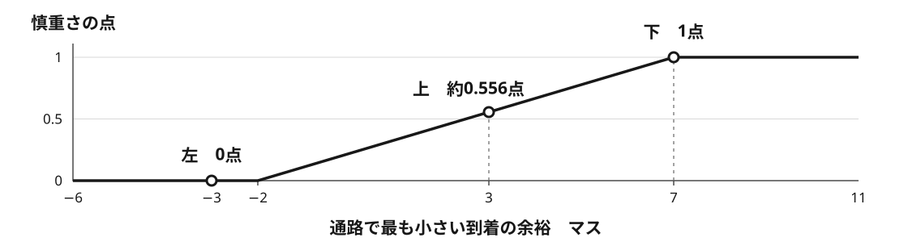

<!-- _class: junction -->

# パックマンの進路選択と Utility AI

ゴースト2体の迷路で右へ3手　上へ2手進んだ交差点

- ↑ 上のエサ
- ← 左のエサ
- **現在地**
- 壁
- ↓ 通過済み

均等配分ではエサのある **上へ**　慎重さを重視すると今来た道を **下へ**

---

<!-- _class: flow -->

## 観測から次の1手までの流れ

1. **観測**\
   通れる各方向のエサと敵までの距離を測る
2. **採点**\
   応答曲線などの式で各方向に4項目の点を付ける
3. **重み付け**\
   各項目の点に性格の重みを掛けて合計
4. **選択**\
   総合点が最大の方向へ1マス移動

たとえば下の慎重さが1点なら　重み25%では0.25点　重み70%では0.70点を加算

160ミリ秒ごとに再評価　同点なら直進を優先　次に 上 → 左 → 下 → 右 の順

---

## 盤面の値を点数に変える応答曲線

応答曲線は観測値を評価点に変える関数　このデモでは人が曲線の形を決める

**近さ**　4マスから0マスなら0.50点上昇　12マスから8マスなら約0.08点上昇\
**慎重さ**　余裕が−2マス以下なら0点　3マスなら約0.56点　7マス以上なら1点

---

## 同じ交差点での3方向の評価点

| 方向 | 目先の採餌 | 全体の回収 | 慎重さ | パワー活用 |
|:---|---:|---:|---:|---:|
| ↑ 上 | **1.000** | **1.000** | 0.556 | 0.204 |
| ↓ 下 | 0.442 | 0.833 | **1.000** | 0.238 |
| ← 左 | **1.000** | 0.000 | 0.000 | 0.204 |

上はすぐにエサを取れて残りのエサも回りやすい\
下はエサを取りにくい一方でゴーストとの距離に余裕がある

**均等配分で上に進むときの総合点**\
0.25 × 1 ＋ 0.25 × 1 ＋ 0.25 × 0.556 ＋ 0.25 × 0.204 ≈ **0.690**

---

## 重みの配分による進路の逆転

下は慎重さの得点だけで上の総合点 **0.649** を上回る

---

## 目先の採餌と4手先までのエサ

最初の1歩を決めてから引き返さずに拾えるエサの最大数を調べる\
通常のエサもパワーエサも1個として数える

| 最初の1歩 | 4手で拾える最大数 | 1歩先から最寄りのエサまで | 目先の点 |
|:---|---:|---:|---:|
| ↑ 上 | 4個 | 0マス | **1.000** |
| ↓ 下 | 2個 | 2マス | **0.442** |

> 目先の点 ＝ 0.65 × 最大数 ÷ 4 ＋ 0.35 ÷（1 ＋ 最寄りのエサまでの距離）

下へ引き返すとすでに食べた通路を通るため最初の1歩でエサを取れない

---

## 全体の回収とゴールまでの推定歩数

最初の1歩の後は最も近い残りエサを順に訪れると仮定する\
最後のエサまでの合計歩数が短い候補ほど高得点

| 最初の1歩 | 残りのエサを回る推定歩数 | 全体の点 |
|:---|---:|---:|
| ↑ 上 | 183歩 | **1.000** |
| ↓ 下 | 185歩 | 0.833 |
| ← 左 | 195歩 | 0.000 |

> 全体の点 ＝（最長の候補歩数 − この候補の歩数）÷ 歩数差\
> 歩数差には最長と最短の差を使い 4未満なら4を使う

---

## 慎重さを決める到着の余裕

分岐か行き止まりまでの各マスで比較　パワーエサがあればその手前まで

| 左へ進む距離 | 1マス | 2マス | 3マス | 4マス | 5マス | 6マス |
|:---|---:|---:|---:|---:|---:|---:|
| 自分の歩数 | 1 | 2 | 3 | 4 | 5 | 6 |
| 敵の最短距離 | 8 | 7 | 6 | 5 | 4 | 3 |
| 到着の余裕 | ＋7 | ＋5 | ＋3 | ＋1 | **−1** | **−3** |

余裕 ＝ 敵の最短距離 − 自分の歩数　　慎重さ ＝（通路の最小の余裕 ＋ 2）÷ 9\
結果を0〜1に収めると **左の慎重さは0点**

---

## パワー活用の対象と残り時間

通常時はパワーエサを目指し　パワー中は捕まえられる敵を目指す

| 状態 | 加点の仕組み |
|:---|:---|
| 通常 | 1歩先からパワーエサが近いほど加点　敵が迫るとさらに加点 |
| パワー中 | 最初の1歩も含めて時間内に敵に届くときだけ敵の近さを加点 |

**1歩進んだ先から敵まで3マスの場合**\
残り4手なら約0.57点　残り3手なら間に合わず0点

> 近さ ＝ 1 ÷（1 ＋ 距離 ÷ 4）\
> 通常の点 ＝ エサの近さ ×（0.55 ＋ 0.45 × 敵の近さ）

---

<!-- _class: flow -->

## 応答曲線と NN の活性化関数の役割

1. **NN の入力**\
   エサの残量や敵の近さなど盤面の12特徴量
2. **隠れ層の ReLU**\
   学習した重みで入力を合成して負の値を0に変換
3. **出力の softmax**\
   4つの出力を合計100%の配分に変換

Utility AI の応答曲線は **各方向の点数** を決める\
学習済みNNは初回と出口が3つ以上のマスで **4項目の重み** を決める

デモの初期値は手動の各25%　モデルを読み込むとNNが配分を更新

学習用の盤面収集には Behavior Tree や固定重みの Utility AI を使用

---

## デモでの進路とゴースト数の比較

**同じ盤面で重みを変える**\
ゴーストが近い交差点で一時停止して慎重さのスライダーを動かす\
矢印の横の総合点を見てから再開すると選ばれた方向を確かめられる

**同じ重みでゴースト数を変える**\
0体なら全方向の慎重さは1点　4体なら各マスに最短で届く活動中の敵を参照\
待機中の敵は除外　パワー中は全方向の慎重さが1点

[標準の2体で開始](https://yuuono.github.io/packmanNN/?agent=utility)　 [0体で比較](https://yuuono.github.io/packmanNN/?agent=utility&ghosts=0)　 [4体で比較](https://yuuono.github.io/packmanNN/?agent=utility&ghosts=4)

[採点式の実装](https://github.com/yuuono/packmanNN/blob/main/ai/utility.js)　 [NNの呼び出し条件](https://github.com/yuuono/packmanNN/blob/main/ai/controller.js)　 [学習方針](https://github.com/yuuono/packmanNN/blob/main/TRAINING_PLAN.md)

応答曲線の設計例　[Mike Lewis　Game AI Pro 3 第13章](https://www.gameaipro.com/GameAIPro3/GameAIPro3_Chapter13_Choosing_Effective_Utility-Based_Considerations.pdf)
