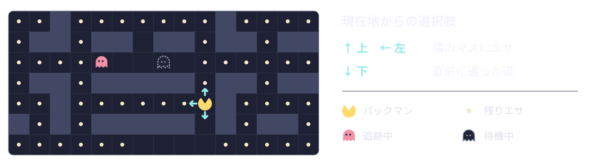
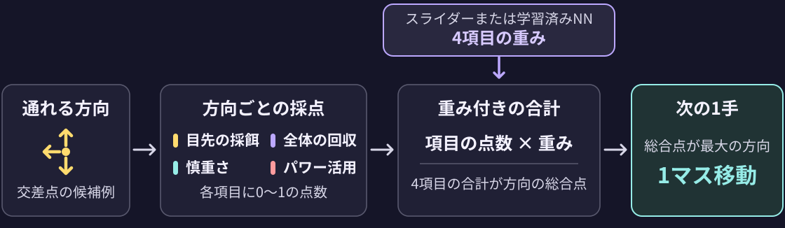
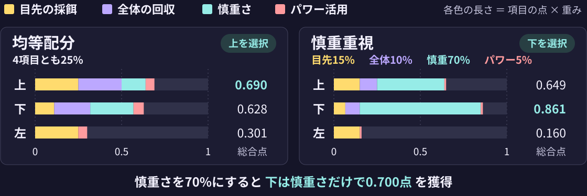
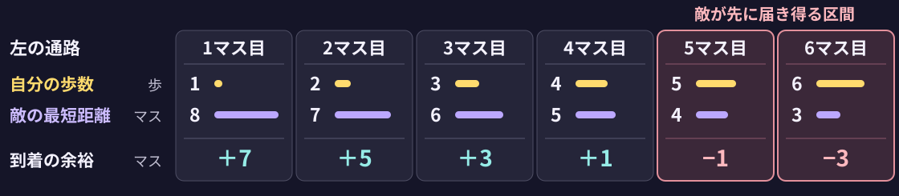

# パックマンの進路選択と Utility AI

均等配分で5手進んだ交差点　上と左にはエサ　下は今来た道

**この盤面で均等配分なら上へ　慎重さを重視すると下へ**

---

## Utility AI による次の1手の選択

160ミリ秒ごとに現在の盤面で採点し直す\
同点なら直進を優先　それでも決まらなければ 上 → 左 → 下 → 右 の順

---

## 同じ交差点での3方向の評価点

| 方向 | 目先の採餌 | 全体の回収 | 慎重さ | パワー活用 |
|:---|---:|---:|---:|---:|
| ↑ 上 | **1.000** | **1.000** | 0.556 | 0.204 |
| ↓ 下 | 0.442 | 0.833 | **1.000** | 0.238 |
| ← 左 | **1.000** | 0.000 | 0.000 | 0.204 |

上はすぐにエサを取れて残りのエサも回りやすい\
下はエサを取りにくい一方でゴーストとの距離に余裕がある

**均等配分で上に進むときの総合点**\
0.25 × 1 ＋ 0.25 × 1 ＋ 0.25 × 0.556 ＋ 0.25 × 0.204 ≈ **0.690**

---

## 重みの配分による進路の逆転

下は慎重さの得点だけで上の総合点 **0.649** を上回る

---

## 目先の採餌と4手先までのエサ

最初の1歩を決めてから引き返さずに拾えるエサの最大数を調べる\
通常のエサもパワーエサも1個として数える

| 最初の1歩 | 4手で拾える最大数 | 1歩先から最寄りのエサまで | 目先の点 |
|:---|---:|---:|---:|
| ↑ 上 | 4個 | 0マス | **1.000** |
| ↓ 下 | 2個 | 2マス | **0.442** |

> 目先の点 ＝ 0.65 × 最大数 ÷ 4 ＋ 0.35 ÷（1 ＋ 最寄りのエサまでの距離）

下へ引き返すとすでに食べた通路を通るため最初の1歩でエサを取れない

---

## 全体の回収とゴールまでの推定歩数

最初の1歩の後は最も近い残りエサを順に訪れると仮定する\
最後のエサまでの合計歩数が短い候補ほど高得点

| 最初の1歩 | 残りのエサを回る推定歩数 | 全体の点 |
|:---|---:|---:|
| ↑ 上 | 183歩 | **1.000** |
| ↓ 下 | 185歩 | 0.833 |
| ← 左 | 195歩 | 0.000 |

> 全体の点 ＝（最長の候補歩数 − この候補の歩数）÷ 歩数差\
> 歩数差には最長と最短の差を使い 4未満なら4を使う

---

## 慎重さを決める到着の余裕

分岐か行き止まりまでの各マスで比較　パワーエサがあればその手前まで

余裕 ＝ 敵の最短距離 − 自分の歩数　　慎重さ ＝（通路の最小の余裕 ＋ 2）÷ 9\
結果を0〜1に収めると **左の慎重さは0点**

---

## パワー活用の対象と残り時間

通常時はパワーエサを目指し　パワー中は捕まえられる敵を目指す

| 状態 | 加点の仕組み |
|:---|:---|
| 通常 | 1歩先からパワーエサが近いほど加点　敵が迫るとさらに加点 |
| パワー中 | 最初の1歩も含めて時間内に敵に届くときだけ敵の近さを加点 |

**1歩進んだ先から敵まで3マスの場合**\
残り4手なら約0.57点　残り3手なら間に合わず0点

> 近さ ＝ 1 ÷（1 ＋ 距離 ÷ 4）\
> 通常の点 ＝ エサの近さ ×（0.55 ＋ 0.45 × 敵の近さ）

---

## NN と Utility AI の役割分担

> 盤面の12特徴量 → NN → 4つの重み → Utility AI → 次の1手

| モード | 重みの決め方 | 更新のタイミング |
|:---|:---|:---|
| スライダー | 人が配分を指定 | スライダーの操作時 |
| 学習済みNN | 盤面の特徴から予測 | 初回と出口が3つ以上のマス |

公開デモの初期値は各25%\
学習済みモデルを読み込むとエサの残量や敵の近さに応じてNNが配分を更新\
次の交差点まではその配分で Utility AI が毎手の方向を選ぶ

学習用の盤面収集には Behavior Tree や固定重みの Utility AI も使用

---

## デモでの進路とゴースト数の比較

**同じ盤面で重みを変える**\
ゴーストが近い交差点で一時停止して慎重さのスライダーを動かす\
矢印の横の総合点を見てから再開すると選ばれた方向を確かめられる

**同じ重みでゴースト数を変える**\
0体なら全方向の慎重さは1点　4体なら各マスに最短で届く活動中の敵を参照\
待機中の敵は除外　パワー中は全方向の慎重さが1点

[標準の2体で開始](https://yuuono.github.io/packmanNN/?agent=utility)　 [0体で比較](https://yuuono.github.io/packmanNN/?agent=utility&ghosts=0)　 [4体で比較](https://yuuono.github.io/packmanNN/?agent=utility&ghosts=4)

[採点式の実装](https://github.com/yuuono/packmanNN/blob/main/ai/utility.js)　 [NNの呼び出し条件](https://github.com/yuuono/packmanNN/blob/main/ai/controller.js)　 [学習方針](https://github.com/yuuono/packmanNN/blob/main/TRAINING_PLAN.md)
