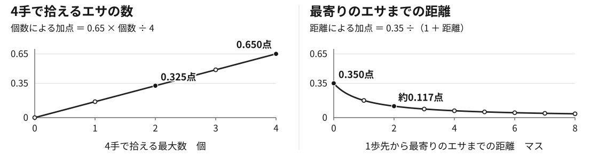
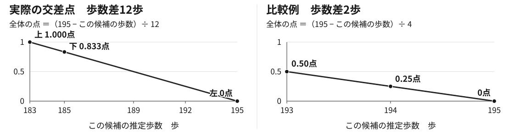
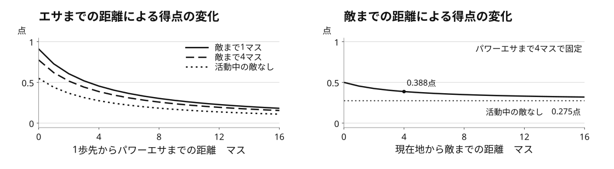
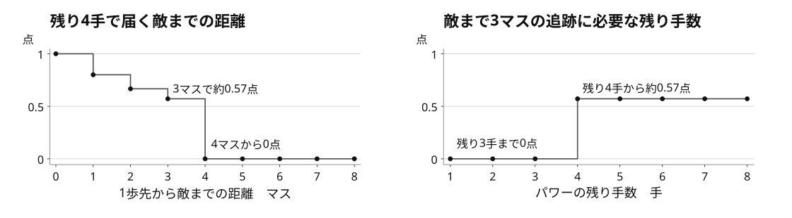

<!-- _class: junction -->

# パックマンの進路選択と Utility AI

ゴースト2体の迷路で右へ3手　上へ2手進んだ交差点

- ↑ 上のエサ
- ← 左のエサ
- **現在地**
- 壁
- ↓ 通過済み

均等配分ではエサのある **上へ**　慎重さを重視すると今来た道を **下へ**

---

<!-- _class: hybrid -->

## Utility AI と NN のハイブリッド構成

太枠の NN が引き受けるのは **人がスライダーで決めていた4項目の配分**

- **公開中の AI 実験の初期設定**\
  人がスライダーで設定　初期値は各25%
- **学習済み JSON の読み込み後**\
  盤面の12特徴量 → NN が配分を推論
- **選んだモードの重み**\
  目先の採餌　全体の回収\
  慎重さ　パワー活用
- **盤面 → 手書きの採点式**\
  通れる方向ごとに4項目を採点
- **Utility AI の総合点**\
  方向ごとに 点数 × 重み を合計
- **次の1手**\
  総合点が最大の方向へ1マス移動

公開デモは手動配分で自動操縦　NN の利用には学習済み JSON が必要

---

## 進路の採点に使う応答曲線の一覧

応答曲線は距離や個数などの観測値を評価点に変える関数

| 頁 | 採点項目 | 入力と得点の関係 |
|---:|:---|:---|
| 4 | 目先の採餌 | エサの数に比例して加点　距離で減衰 |
| 5 | 全体の回収 | 推定歩数が短い候補ほど高得点 |
| 6 | 慎重さ | 余裕が増すと直線的に上昇　両端で一定 |
| 7 | パワー活用　通常時 | エサに近いほど加点　敵の近さで増幅 |
| 8 | パワー活用　パワー中 | 時間内に届くときだけ敵の近さで加点 |

同じ4項目を毎手採点　パワー活用の式は効果の有無で切り替わる

---

## 目先の採餌　個数と距離の加点

最初の1歩を固定し引き返さずに4手で拾える最大数を調べる\
通常のエサもパワーエサも1個として数える

目先の点 ＝ 0.65 × 最大数 ÷ 4 ＋ 0.35 ÷（1 ＋ 距離）

上は4個と距離0で **1点**　下は2個と距離2で **約0.442点**

---

## 全体の回収　他の候補との歩数差

各方向へ踏み出した後に近いエサから順に回収すると仮定して全回収までの歩数を見積もる

全体の点 ＝（最長歩数 − その方向の歩数）÷ 分母\
分母は最長と最短の差　差が4歩未満なら4を使う

候補間の差が2歩なら最短でも **0.5点**　全候補が同じ歩数なら **すべて0点**

---

## 慎重さ　通路で最も小さい到着余裕

次の分岐か行き止まりまでの各マスで **敵の最短距離 − 自分の歩数** を比較\
途中にパワーエサがあればその手前までを調べる

慎重さ ＝（最小の余裕 ＋ 2）÷ 9 を0〜1に収めた値

左に6マス進むと敵はそこまで3マス　最小の余裕が **−3** なので **0点**\
パワー中や活動中の敵がいないときは全方向が **1点**

---

## 通常時のパワー活用　エサと敵の距離

パワーエサの距離は **1歩先** から　敵の距離は **現在地** から測る

近さ ＝ 1 ÷（1 ＋ 距離 ÷ 4）\
パワーの点 ＝ エサの近さ ×（0.55 ＋ 0.45 × 敵の近さ）

活動中の敵がいなければ係数は **0.55**　パワーエサが尽きると **0点**

---

## パワー中の追跡　距離と残り時間の境界

1歩先から活動中の敵までの最短距離を使う　最初の1歩にも1手かかる

**距離 ＋ 1 ≦ 残り手数** なら点は 1 ÷（1 ＋ 距離 ÷ 4）　届かなければ **0点**

敵まで3マスなら残り3手で **0点**　残り4手で **約0.57点**\
活動中の敵がいなければ0点　効果が切れると通常時の採点へ戻る

---

## 同じ交差点での3方向の評価点

| 方向 | 目先の採餌 | 全体の回収 | 慎重さ | パワー活用 |
|:---|---:|---:|---:|---:|
| ↑ 上 | **1.000** | **1.000** | 0.556 | 0.204 |
| ↓ 下 | 0.442 | 0.833 | **1.000** | 0.238 |
| ← 左 | **1.000** | 0.000 | 0.000 | 0.204 |

上はすぐにエサを取れて残りのエサも回りやすい\
下はエサを取りにくい一方でゴーストとの距離に余裕がある

**均等配分で上に進むときの総合点**\
0.25 × 1 ＋ 0.25 × 1 ＋ 0.25 × 0.556 ＋ 0.25 × 0.204 ≈ **0.690**

---

## 重みの配分による進路の逆転

左は手動の初期値　右は仕組みを示すための固定配分の例\
NN が右と同じ配分を返す場合も上は **0.649点**　下は **0.861点** となり下へ進む

---

<!-- _class: flow -->

## NN の重み更新と Utility AI の移動周期

1. **NN の入力**\
   エサの残量や敵の近さなど盤面の12特徴量
2. **隠れ層の ReLU**\
   16個のユニットで特徴を合成して負の値を0に変換
3. **出力の softmax**\
   4つの出力を合計100%の配分に変換

| ブラウザでの判断 | 初回 | 通路の各マス | 次の交差点 |
|:---|:---|:---|:---|
| NN の重み | 配分を推論 | 直前の配分を保持 | 盤面から再推論 |
| Utility AI の進路 | 採点して選択 | 毎手採点して選択 | 採点して選択 |

交差点は出口が3つ以上のマス　移動は1手160ミリ秒\
同点なら直進を優先　次に 上 → 左 → 下 → 右 の順

---

<!-- _class: flow -->

## サーバーでの学習とブラウザへの受け渡し

1. **交差点の収集**\
   Behavior Tree や固定重みの Utility AI で迷路をプレイ
2. **配分の比較**\
   同じ交差点から5種類の固定配分でそれぞれ最大32手を試行
3. **重みの学習**\
   標準は成績差のある盤面から勝者の配分を学習
4. **デモでの推論**\
   学習済み JSON を読み込みブラウザで新しい盤面の配分を推論

Behavior Tree の役割は学習に使う盤面の収集\
モデル読み込み後のプレイでは **NN が決めた配分** と **手書きの Utility AI** で自動操縦

---

## デモでの進路とゴースト数の比較

**同じ盤面で重みを変える**\
ゴーストが近い交差点で一時停止して慎重さのスライダーを動かす\
矢印の横の総合点を見てから再開すると選ばれた方向を確かめられる

**同じ重みでゴースト数を変える**\
0体なら全方向の慎重さは1点　4体なら各マスに最短で届く活動中の敵を参照\
待機中の敵は除外　パワー中は全方向の慎重さが1点

[標準の2体で開始](https://yuuono.github.io/packmanNN/?agent=utility)　 [0体で比較](https://yuuono.github.io/packmanNN/?agent=utility&ghosts=0)　 [4体で比較](https://yuuono.github.io/packmanNN/?agent=utility&ghosts=4)

[採点式の実装](https://github.com/yuuono/packmanNN/blob/main/ai/utility.js)　 [NNの呼び出し条件](https://github.com/yuuono/packmanNN/blob/main/ai/controller.js)　 [学習方針](https://github.com/yuuono/packmanNN/blob/main/TRAINING_PLAN.md)

応答曲線の設計例　[Mike Lewis　Game AI Pro 3 第13章](https://www.gameaipro.com/GameAIPro3/GameAIPro3_Chapter13_Choosing_Effective_Utility-Based_Considerations.pdf)
